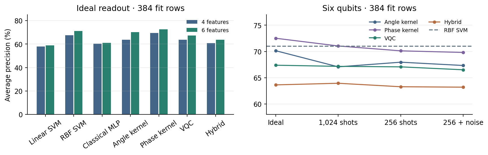
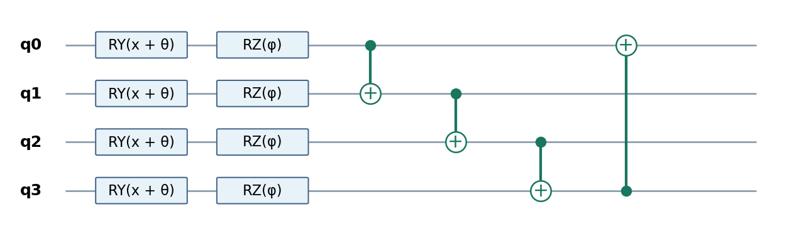

# Quantum vs. Classical Intrusion Detection

A measured comparison of fidelity kernels, variational circuits, a quantum-classical hybrid and classical baselines on matched UNSW-NB15 features.

## Findings

At 384 training rows and six PCA features, the ideal phase fidelity kernel reached **72.51% average precision**, compared with **71.02%** for the RBF SVM. The paired change was **+1.49 percentage points** (95% bootstrap interval **−0.73 to +4.00**). With 256 shots and 8% outcome mixing, phase-kernel AP dropped to **69.81%**. The study establishes performance for these encodings, samples, and simulated conditions.

| Six-feature model | Ideal AP | AP with 256 shots + noise | Mean ideal fit time |
|---|---:|---:|---:|
| Linear SVM | 58.80% | — | 9.9 ms |
| RBF SVM | 71.02% | — | 10.2 ms |
| Classical MLP | 61.12% | — | 47.3 ms |
| Angle fidelity kernel | 70.14% | 67.33% | 27.8 ms |
| Phase fidelity kernel | 72.51% | 69.81% | 30.8 ms |
| Variational circuit | 67.38% | 66.51% | 484.5 ms |
| Hybrid | 63.63% | 63.19% | 478.1 ms |

Training and inference times are CPU simulator measurements. Readout and device execution costs need hardware experiments.



## Model and comparison



- Same training draws, validation examples and test rows for every model, with train-only transforms and duplicate control.
- Four and six PCA dimensions, 192 and 384 training examples, five seeds, and 380 measured model-condition rows.
- Ideal, 1,024-shot and 256-shot measurements, plus an 8% global depolarizing outcome mixture at 256 shots.
- Entangled circuit gradients, fused phase gates and fidelity Gram projection verified numerically.

## Reproduce

```sh
python -m venv .venv
source .venv/bin/activate
python -m pip install torch==2.15.0 --index-url https://download.pytorch.org/whl/cpu
python -m pip install -e '.[report]'
OPENBLAS_NUM_THREADS=1 OMP_NUM_THREADS=1 python -m unittest discover -s tests -v
python scripts/download_unsw.py
OPENBLAS_NUM_THREADS=1 OMP_NUM_THREADS=1 python -m qids.benchmark
gzip -nc results/study.json > results/study.json.gz
python scripts/report.py
```

[Technical report](results/quantum-intrusion-detection-report.pdf) · [Methodology and references](docs/METHODOLOGY.md) · [Interview preparation and résumé drafts](docs/INTERVIEW.md)

The experiments use a balanced subset of a single controlled network-flow corpus. Simulation uses small circuits and a single global noise model. Code development was AI-assisted.
